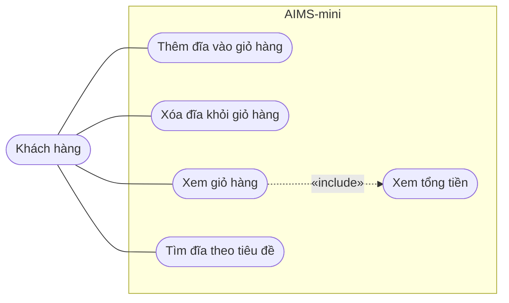

# Biểu đồ use case – AIMS-mini

Tác nhân: **Khách hàng**, dùng chương trình dòng lệnh để quản lý giỏ hàng DVD.

| Use case | Hàm thực hiện |
|---|---|
| Thêm đĩa vào giỏ hàng | `Cart.add_dvd()` |
| Xóa đĩa khỏi giỏ hàng | `Cart.remove_dvd()` |
| Xem giỏ hàng | `Cart.print_cart()` |
| Xem tổng tiền | `Cart.total_cost()` |
| Tìm đĩa theo tiêu đề | `search_by_title()` |
